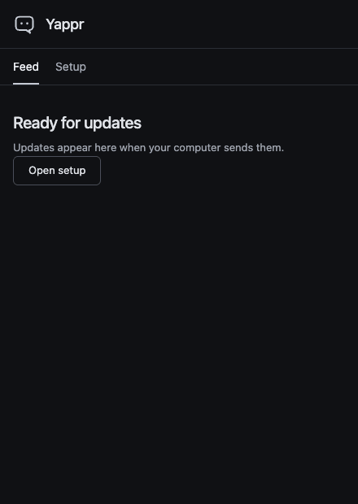
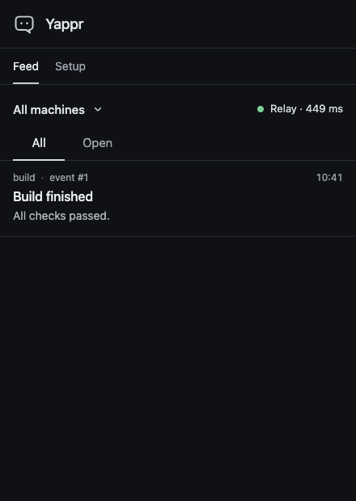

# Yappr app

Read updates and answer questions from your machines at [yappr.run](https://yappr.run/).
The app works in a browser on your phone or computer. You do not need an account.
Connections are end-to-end encrypted. An [iroh](https://www.iroh.computer/) [relay](https://docs.iroh.computer/concepts/relays) carries the browser's
traffic and cannot read your entries or answers.



## Connect your phone

On your computer, [install the Yappr CLI](https://github.com/fractalops/yappr#install), then create a pairing code:

```sh
yappr start --pair
```

Leave this terminal open. The QR code and `YAPPR:` code expire after five minutes.
If Yappr is already running, use `yappr pair` in a second terminal.

On your phone:

1. Open [yappr.run](https://yappr.run/) and select **Setup**.
2. Scan the QR code. You can also import a QR image or paste the `YAPPR:` code.
3. Set **Your device name** to `phone`, then select **Request pairing**.
4. Compare the check code on your phone with the check code in the computer's terminal.

If the codes match, enter `y` in that terminal. If they differ, enter `n`.
The computer prints the saved alias. Use that alias in the examples below.

In a second terminal on the same computer, send an update:

```sh
echo "Backup complete" | yappr post --source backup
```

On your phone, select **Feed** to see **Backup complete**.

## Get notifications when Yappr is closed

Use a writer that supports Web Push. In **Setup**, open **Advanced settings**.
Select **Notify me when this page is closed** and allow browser notifications.
Yappr sends a notification for a question, a warning, or an alert.
Select the notification to open Yappr. Answer questions in the app.

On an iPhone with iOS 16.4 or later, add Yappr to your Home Screen first.
Open it from there to pair your computer and allow notifications.

## Answer a request

On your computer, ask for approval:

```sh
yappr approve phone "Continue the backup?"
```

Select a choice on your phone. Use **Undo** within five seconds if needed.
The answer stays queued on this device until the computer saves it.
**Open** shows questions waiting for your answer.



## More

See the [CLI reference](https://github.com/fractalops/yappr/blob/main/docs/reference.md)
for command options and delivery behavior.
For local builds, tests, and source layout, see [Contributing](CONTRIBUTING.md).
